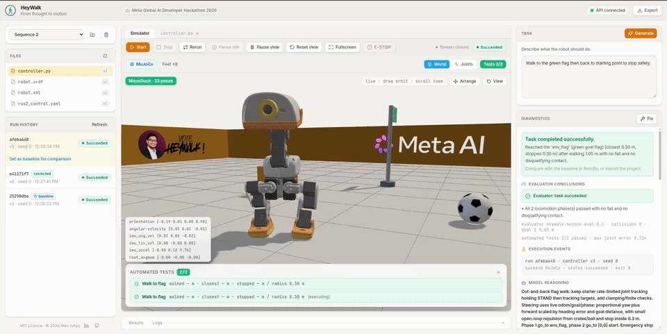

<div align="center">

# HeyWalk

**Buktikan program robot buatan AI benar-benar berjalan.**

AI × Robotika × Simulasi

</div>

<p align="center">
  <a href="LICENSE"></a>
  <a href="services/api/pyproject.toml"></a>
  <a href="apps/web"></a>
  <a href="https://docs.ros.org/en/jazzy/"></a>
  <a href="https://mujoco.org/"></a>
  <a href="https://onnxruntime.ai/"></a>
</p>

<p align="center">
  <a href="https://heywalk.biz.id/id/"><strong>Website (Bahasa Indonesia)</strong></a> ·
  <a href="https://heywalk.biz.id">Website (English)</a> ·
  <a href="https://forms.gle/PeFbz6iE5rFzi1sx6"><strong>Ajukan Pilot Kampus/SMK</strong></a> ·
  <a href="https://www.linkedin.com/company/heywalk-robotics">LinkedIn</a>
</p>

<p align="center">
  
</p>

> **English summary** at the bottom. Full technical docs (English) moved to [README_HACKATHON.md](README_HACKATHON.md).

HeyWalk mengubah maksud manusia menjadi perilaku robot yang bisa dijalankan. Lalu menjalankannya di simulasi berbasis lingkungan fisik, mengukur hasilnya, dan memakai bukti tersebut untuk perbaikan.

**Kode yang terlihat benar belum tentu terbukti berjalan.** HeyWalk memperlakukan kode robot buatan AI sebagai eksperimen: dijalankan di dunia simulasi, diukur secara independen, dan bukti kegagalannya dikirim kembali ke siklus perbaikan.

<br/>

## 🎓 Ajakan untuk Kampus & SMK Indonesia

**Generasi talenta robotika berikutnya dimulai sebelum industrinya tiba.**

Pelajar Indonesia tak perlu menunggu hardware robot yang mahal untuk mulai belajar robotika. Dengan eksperimen *simulation-first*, kampus dan SMK bisa memperkenalkan pemrograman robot, logika kontrol, pengembangan berbantuan AI, dan pengujian berbasis bukti hanya dengan komputer yang terjangkau.

Kami mencari **universitas, politeknik, klub robotika, dosen, dan program SMK** yang tertarik menjajaki **pilot HeyWalk yang praktis**.

<p align="center">
  <a href="https://forms.gle/PeFbz6iE5rFzi1sx6"><strong>→ Isi formulir pilot (±1 menit)</strong></a>
</p>

Kami balas dalam **2 hari kerja**.

### Untuk siapa?

| | |
|---|---|
| **Universitas & Politeknik** | Bawa eksperimen robotika berbantuan AI ke lingkungan belajar robotika, mekatronika, ilmu komputer, dan teknik. |
| **SMK** | Kenalkan siswa pada pemrograman, konsep otomasi, simulasi, dan dasar-dasar robotika — tanpa harus mulai dengan armada robot yang mahal. |
| **Klub robotika** | Beri tim siswa lingkungan bersama untuk memprototipe perilaku, menguji ide, memeriksa kegagalan, dan membandingkan iterasi. |
| **Mitra industri** | Bantu membentuk jalur belajar praktis dan kenalkan talenta baru pada *tools* dan cara berpikir di balik pengembangan robotika. |

### Apa yang dibutuhkan untuk ikut pilot?

- **Komputer biasa + internet.** Tidak perlu robot fisik — semua berjalan di simulasi.
- **Satu dosen/guru atau ketua klub** sebagai penanggung jawab.
- **Kemauan eksperimen.** Siswa menulis tugas dengan bahasa biasa, AI membuat kontrolernya, simulasi membuktikan hasilnya.

### Mari buat robotika lebih mudah diakses di Indonesia

Mulai dari simulasi. Bangun keterampilannya. Siap untuk peluang di depan.

<br/>

## Bagaimana HeyWalk bekerja?

Siklus eksperimen lengkap yang menghubungkan logika kontrol buatan AI dengan perilaku robot yang teramati.

```text
Tugas → Kontroler → Simulasi MuJoCo → Verdict Terukur
```

| # | Langkah | Isinya |
|---|---|---|
| 1 | **BUAT — Deskripsikan tugasnya** | Tulis apa yang ingin robot lakukan dengan bahasa biasa. Model AI mengubahnya menjadi objektif dan kontroler ROS 2 Python. |
| 2 | **JALANKAN — di simulasi** | Kontroler berjalan di container terisolasi dan berkomunikasi lewat ROS 2 topics. MuJoCo menjalankan fisika robot. |
| 3 | **VERIFIKASI — periksa hasilnya** | Evaluator independen memeriksa telemetri terhadap kriteria tugas dan keselamatan. Model tidak bisa menyatakan keberhasilannya sendiri. |
| 4 | **PERBAIKI — diagnosis dan jalankan ulang** | Saat gagal, model AI menerima buktinya, mengusulkan *patch* yang tepat, dan kontroler yang diperbarui diuji lagi di dunia yang sama. |

Setiap *run* menyimpan tugas, versi kontroler, *seed*, log, telemetri, verdict evaluator, dan riwayat koreksi — sehingga perbandingan antar-iterasi bermakna.

Robot simulasi: MicroDuck oleh Pollen Robotics ([CC BY-NC-SA 4.0](https://creativecommons.org/licenses/by-nc-sa/4.0/)).

<br/>

## Coba sendiri dalam 5 menit

### Opsi 1: instal otomatis

```bash
curl -fsSL https://raw.githubusercontent.com/wansatya/heywalk/main/install.sh | bash
```

Lalu buka [http://localhost:8021](http://localhost:8021).

### Opsi 2: jalankan manual (frontend + backend)

Butuh [uv](https://docs.astral.sh/uv/), Python 3.12+, dan Node.js 18+. Siapkan dua terminal.

**Terminal 1 — backend:**

```bash
git clone https://github.com/wansatya/heywalk.git
cd heywalk
cp .env.example .env   # API key bisa diisi belakangan via menu Settings
```

Di `.env`, set `RUNNER_BACKEND=local` (cukup untuk development; tanpa isolasi container).

```bash
cd services/api
uv run --extra test uvicorn app.main:app --port 8000
```

**Terminal 2 — frontend:**

```bash
cd apps/web
npm install
npm run dev
```

Buka [http://localhost:5173](http://localhost:5173) — Vite meneruskan panggilan API ke backend di port 8000.

Tanpa API key pun simulator tetap berjalan; API key hanya dibutuhkan untuk pembuatan dan perbaikan kontroler oleh AI. Atur API URL, nama model, dan API key lewat menu **Settings** (ikon gear) — tanpa restart; endpoint apa pun yang kompatibel dengan OpenAI Chat Completions bisa dipakai.

> Catatan: `RUNNER_BACKEND=local` menjalankan kontroler sebagai subprocess di mesin yang sama (cukup untuk development, tanpa isolasi container). 
Untuk eksekusi run yang terisolasi, instal Docker, bangun image runner sekali (`docker compose --profile runner-build build runner`), lalu set `RUNNER_BACKEND=docker` di `.env`.

Rute API, batasan keselamatan, dan detail teknis ada di [README_HACKATHON.md](README_HACKATHON.md).

<br/>

## Di balik layar

Setiap layer punya tugas yang jelas. AI menulis perilaku tingkat tinggi; komponen simulasi dan *policy* yang mapan menangani dinamika fisik dan gaya berjalan.

| Layer | Tugas |
|---|---|
| Model AI | Menafsirkan tugas, membuat logika kontroler ROS 2, mendiagnosis kegagalan dari bukti eksekusi. |
| Kontroler ROS 2 Python | Navigasi, urutan objektif, batas kecepatan, perilaku berhenti. *(buatan AI)* |
| MuJoCo (200 Hz) | Dinamika rigid-body, gravitasi, kontak tanah, tabrakan, jatuh. |
| ONNX Runtime + MicroDuck policy (50 Hz) | *Policy* velocity/stand bawaan upstream untuk keseimbangan dan gaya berjalan. |
| Evaluator independen | Menilai telemetri terhadap kriteria objektif dan keselamatan. |

Dibangun di atas robotika open-source, dengan bantuan AI: MuJoCo, ONNX, ROS 2, MicroDuck, NumPy, Python, FastAPI, React, Three.js, Hugging Face, dan endpoint Chat Completions apa pun yang kompatibel dengan OpenAI.

<br/>

## Untuk pembuat & vendor robot

Biarkan developer mencoba robot Anda di simulasi. Bagikan file model siap-simulasi (MJCF/URDF + mesh + batas aktuator + lisensi) dan kami akan bekerja sama menambahkan robot Anda sebagai model pilihan. Anda tetap memegang penuh kepemilikan file.

[→ Bagikan model robot Anda](https://github.com/wansatya/heywalk/issues/new?title=Robot%20model%20contribution%3A%20%3Cvendor%3E%20%3Cmodel%3E&body=Company%3A%0ARobot%20model%3A%0AModel%20format%3A%20MJCF%20%2F%20URDF%20%2F%20meshes%20only%20%2F%20other%0ALicense%20for%20the%20model%20files%3A%0AProduct%20URL%3A%0AContact%3A)

<br/>

## Penting: simulasi bukan sertifikasi dunia nyata

HeyWalk adalah prototipe riset *software-in-the-loop*. Keberhasilan simulasi **tidak** membuktikan keamanan robot fisik. Kode buatan AI tidak tepercaya dan berjalan di container terisolasi yang dibatasi sumber dayanya. **Jangan hubungkan prototipe ini ke robot fisik.**

<br/>

## Lisensi & atribusi

Kode dan dokumentasi asli HeyWalk berlisensi Apache-2.0 (lihat [LICENSE](LICENSE)). Komponen pihak ketiga — model & mesh MicroDuck, *walking policy* upstream, MuJoCo, ONNX Runtime — tetap di bawah lisensinya masing-masing. Lihat [THIRD_PARTY_NOTICES.md](THIRD_PARTY_NOTICES.md) untuk inventaris lengkap.

HeyWalk adalah proyek independen yang dibangun untuk Meta Global AI Developer Hackathon 2026 — bukan produk resmi Meta.

<br/>

## Kontak

- 🌐 Website: [heywalk.biz.id/id](https://heywalk.biz.id/id/) ([English](https://heywalk.biz.id))
- 📝 Formulir pilot: [forms.gle/PeFbz6iE5rFzi1sx6](https://forms.gle/PeFbz6iE5rFzi1sx6)
- 💼 LinkedIn: [heywalk-robotics](https://www.linkedin.com/company/heywalk-robotics)
- 💻 Teknis mendalam: [README_HACKATHON.md](README_HACKATHON.md)

<br/>

## English summary

**HeyWalk — Make AI-generated robot behaviors prove they work.** HeyWalk turns human intent into executable robot behavior, runs it in a physics-based simulation (MuJoCo + ROS 2 + an upstream ONNX walking policy), measures what happened with an independent evaluator, and feeds failure evidence back to the configured AI model for targeted fixes.

We are inviting **Indonesian universities, polytechnics, robotics clubs, and vocational high schools (SMK)** to explore a hands-on, simulation-first HeyWalk pilot — no physical robot fleet required, just accessible computers. [Propose a pilot here](https://forms.gle/PeFbz6iE5rFzi1sx6) (±1 minute form, reply within 2 business days). Full technical documentation lives in [README_HACKATHON.md](README_HACKATHON.md).

<br/>

**HeyWalk — From thought to motion.**
