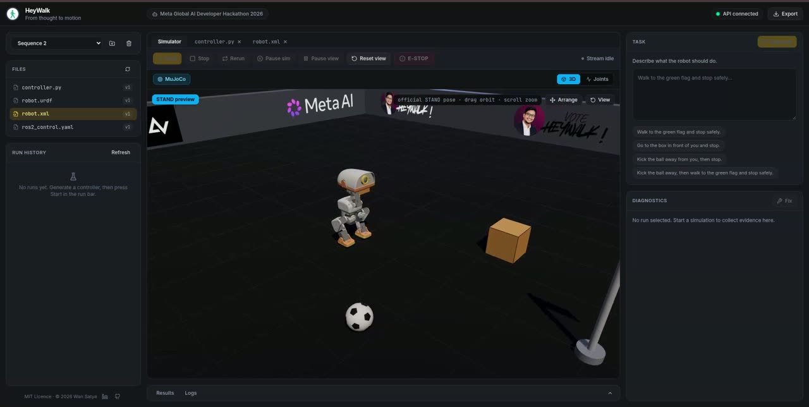

<div align="center"><pre>
██   ██ ███████ ██   ██ ██     ██  █████  ██      ██   ██
██   ██ ██      ██   ██ ██     ██ ██   ██ ██      ██  ██
███████ ██████   ██ ██  ██  █  ██ ███████ ██      ████
██   ██ ██        ███   ██ █ █ ██ ██   ██ ██      ██ ██
██   ██ ██         █    ███   ███ ██   ██ ██      ██  ██
██   ██ ███████    █     ██   ██  ██   ██ ███████ ██   ██
</pre></div>

### Make AI-generated robot behaviors prove they work.

<br/>

<p align="center">
  <a href="LICENSE"></a>
  <a href="services/api/pyproject.toml"></a>
  <a href="apps/web"></a>
  <a href="https://docs.ros.org/en/jazzy/"></a>
  <a href="https://mujoco.org/"></a>
  <a href="https://onnxruntime.ai/"></a>
  <a href="https://ai.meta.com/"></a>
  <a href="docker/runner.Dockerfile"></a>
  <a href="services/api/tests"></a>
</p>

<p align="center">
  <a href="showcase.mp4" title="Play the HeyWalk showcase">
    
  </a>
  <br/>
  <sub>▶ <a href="showcase.mp4">Watch the 73-second showcase</a> (MP4, 11 MB)</sub>
</p>

AI can generate robot code. But generated code is not **proof that a robot can perform the task safely**.

HeyWalk is an AI-powered robotics experiment engine that uses Meta Muse Spark to generate ROS 2 controllers, execute them in a simulated environment, evaluate their behavior against measurable criteria, and diagnose failures so the controller can be improved and tested again.

Instead of asking whether AI can write robotics code, HeyWalk asks a harder question:

**Can AI generate a behavior, observe where it fails, and demonstrate that its correction actually works?**

<br/>

Built for the Meta Global AI Developer Hackathon 2026 — *Push the Frontier*.

**HeyWalk is an independent hackathon project, not an official Meta product.**

<br/>

## Quick install

```bash
curl -fsSL https://raw.githubusercontent.com/wansatya/heywalk/main/install.sh | bash
```

Installs Docker when missing, clones this repo to `~/.heywalk`, builds the images, and starts the stack. Then open [http://localhost:8021](http://localhost:8021). The installer asks for an optional Meta API key (needed only for AI controller generation and correction — the simulator runs without one); in non-interactive shells set `MODEL_API_KEY` instead and the prompt is skipped. `WEB_PORT` overrides the browser port.

<br/>

## The idea: Close the loop between AI and robot behavior

Most AI coding workflows end when code is generated. Robotics needs another step: execution in an environment where the consequences of that code can be observed and measured.

HeyWalk connects four capabilities into one experiment loop:

- **Generate:** Meta Muse Spark translates natural-language instructions into a ROS 2 Python controller.
- **Execute:** The controller runs in an isolated environment and communicates with a robot simulation through real ROS 2 topics.
- **Verify:** An independent evaluator checks the robot's actual simulated behavior against task and safety criteria.
- **Improve:** When a run fails, Muse Spark receives structured evidence, proposes a targeted correction, and the updated controller is tested again in the same scenario.

```text
Human intent
     |
     v
Muse Spark generates a controller
     |
     v
ROS 2 execution + simulated environment
     |
     v
Observed behavior and telemetry
     |
     v
Independent evaluation
     |
     +---- Pass ----> Record verified result
     |
     +---- Fail ----> Diagnose -> Patch -> Rerun
                                      |
                                      v
                              Compare outcomes
```

*The evaluator does not trust the model's claims. It determines success from simulation state and recorded telemetry.*

**The result is an evidence-driven robotics workflow, not just an AI-generated code sample.**

<br/>

## The demo sequence

The default sequence walks a free-standing biped: the official Pollen Robotics **MicroDuck**, simulated with **MuJoCo** as the source of truth for dynamics, and driven by the upstream **ONNX walking policy** for its gait. The user describes a behavior — for example:

> Kick the white ball away from you, then walk to the orange crate behind you and stop safely.

HeyWalk turns that instruction into an ordered sequence of objectives (`kick` the ball, then `go_to` the crate), generates a ROS 2 controller that steers the walking policy phase by phase, runs it in the isolated runner, and records what actually happened: distance walked, closest approach, contact events, trunk height, ball displacement, emergency-stop latency, and per-phase timing.

If the robot falls short, stops too early, or misses the ball, the failure is measured — not assumed. That evidence is sent to Muse Spark, which returns a targeted patch. The controller is rerun in the same world with the same seed, and the two runs are compared side by side.

Each sequence preserves the connection between:

- The original task and the objective sequence derived from it.
- The controller version that ran.
- The environment, prop layout, and random seed.
- Execution logs and sensor telemetry.
- The evaluator's verdict and metrics, including per-phase evidence.
- The proposed correction and its subsequent result.

This makes the improvement inspectable and reproducible instead of relying on a convincing AI explanation.

<br/>

## What makes HeyWalk different?

HeyWalk treats generated robot code as something to be **tested and verified**, not something to be trusted because a model produced it.

| Conventional AI coding workflow | HeyWalk |
|---|---|
| Generates code | Generates an executable robot controller |
| Reports what the code should do | Observes what the robot actually does in simulation |
| Relies on AI explanations | Uses an independent evaluator |
| Fixes code based on a prompt | Uses recorded failure evidence to guide corrections |
| Shows a final answer | Preserves sequence history and before-and-after results |

The key capability is the feedback loop connecting AI-generated control logic to observable robot behavior.

<br/>

## How a run works, end to end

This is the actual pipeline, not a conceptual one. Every step below is implemented, tested, and reachable from the UI.

### 1. Describe the behavior

The user creates a **sequence** (the UI term for a project) and writes the task in plain English. The task text is stored with the project and travels with every run, generation, diagnosis, and export.

### 2. Generate the controller

`POST /api/projects/{id}/generate` asks Muse Spark for a structured response:

| Field | Purpose |
|---|---|
| `summary` | The controller's approach in plain language |
| `assumptions` | What the model assumed about the world |
| `files` | The controller (`controller.py`), robot description (`robot.xml`), and any supporting files |
| `expected_behavior` | What should happen when the task succeeds |
| `safety_considerations` | Speed limits, stop behavior, fallbacks |
| `objectives` | The ordered phases the behavior must achieve: `go_to`, `kick`, `touch`, or `wander` |

The response is JSON-schema constrained, validated with pydantic, and written only to approved project paths. A robot description is validated as MJCF, and the matching URDF and `ros2_control.yaml` are synthesized when the model omits them. The declared objectives become the run's world configuration, so the model's interpretation of the task is what gets graded — the platform does not reinterpret the task behind the model's back.

For MicroDuck projects the prompt also carries an exact robot brief: the 14 actuated joints in actuator order, their limits, the STAND home pose, the available prop bodies (`env_flag`, `env_ball`, `env_box_1`, `env_box_2`), the spawn point and facing, and the grading rules. Generation is told to **adapt the installed starter controller** rather than rewrite it, and to branch on `/objective_state` per phase.

### 3. Stage and execute in isolation

`POST /api/projects/{id}/runs` creates a run record with a frozen world configuration, then the execution manager:

1. stages the project files into a per-run workspace (read-only inside the runner);
2. starts **one single-use container** (`docker_runner.py`) or, in development, a subprocess with scrubbed environment (`local_runner.py`);
3. runs `app/runner/harness.py`, which loads the robot model, wires the ROS 2 transport, drives the simulation loop, and writes telemetry.

The generated controller is never imported into the API process. The runner gets no Docker socket, no secrets, no host credentials, and no network.

### 4. Run the control loop

Two modes share one harness and one controller file:

**Locomotion runs (the default mode).** The harness owns the low-level gait: it steps the walking policy at 50 Hz and applies its joint targets to MuJoCo. The generated controller sees `/joint_states`, `/odom`, `/goal_pose`, `/objective_state`, and `/emergency_stop`, and steers with `/cmd_vel`. Each control tick:

1. read MuJoCo state (IMU angular velocity, root orientation, joint positions and velocities);
2. run the 61-D → 14-D ONNX policy with the controller's current twist command;
3. write the resulting position targets to the emulated `ros2_control` command interface;
4. advance MuJoCo physics four fixed steps (`dt = 0.005`, i.e. 200 Hz physics for a 50 Hz control loop);
5. accumulate phase evidence: distance travelled, closest approach, contacts, trunk height, ball displacement, emergency-stop timing;
6. sample telemetry at 20 Hz and append it to `telemetry.jsonl`.

**Joint-test runs.** The platform owns an automated suite derived from the model's actuated joints. Each case commands a target angle, waits for the settle, and grades measured position, velocity, effort, contacts, and settling time, resetting physics between cases.

### 5. Observe

The API tails `telemetry.jsonl` and streams it to the browser on `WS /api/runs/{id}/stream`. The 3D view renders the newest sample: trunk pose, joint gauges, contact state, trunk height, and the objective sequence with per-phase timing. Full history is always available from `GET /api/runs/{id}/telemetry`, so a skipped live sample is never lost.

### 6. Evaluate

When the run ends, the evaluator reads the recorded evidence — never the controller's self-report, never the model's explanation — and writes `run_metrics` plus a structured report with human-readable reasons (`app/services/evaluation.py` → `app/simulator/locomotion.py` for walks, `app/simulator/mujoco_tests.py` for joint tests, `app/simulator/evaluator.py` for the 2D arena).

Run states are validated and timestamped: `queued → preparing → running → evaluating → succeeded | failed | timeout | cancelled | error`. A completed run always carries a verdict or an explicit evaluation error.

### 7. Diagnose and fix

`POST /api/projects/{id}/fix` sends a bounded evidence bundle to Muse Spark: the task, the controller sources, the robot description, the relevant logs, the telemetry tail, and the evaluator report with per-phase results. The model returns:

| Field | Purpose |
|---|---|
| `failure_hypothesis` | The most likely cause |
| `evidence` | Which observations support it |
| `proposed_change` | The minimal correction |
| `updated_files` | The changed files |
| `expected_improvement` | What should measurably change |

Corrections are validated (approved paths only, robot package re-validated), snapshotted so the previous version can be restored, and shown as a diff before execution. Automatic correction attempts are capped (default 2); repeated failure surfaces the evidence instead of looping.

### 8. Rerun and compare

`POST /api/runs/{id}/rerun` starts a fresh run with the **same world configuration and seed**, linked to its parent. Both runs and both code versions stay available. The comparison shows measured metrics from actual execution — and it says so plainly when a correction did not improve anything.

### 9. Export

`GET /api/projects/{id}/export` returns a ZIP with the project source, its configuration, and the run summary. API keys and host paths are never included.

<br/>

## Two engines: MuJoCo for physics, ONNX for the gait

HeyWalk does not simulate an abstract "robot that moves". It simulates a real biped with real contact, and it does not ask the AI to invent walking. Two fixed engines handle the physics-level reality; the AI writes the control logic above them.

### MuJoCo — the physics engine

[MuJoCo](https://mujoco.org/) is a rigid-body physics engine written in C. In HeyWalk it answers one question per step: *given these joint position targets and the current state, where is the robot now?*

- **Model:** the official Pollen Robotics MicroDuck MJCF (`robot_groundcontact.xml`), composed with a ground plane, the official `INIT`/`STAND`/`SIT`/`FOLD` keyframes, and the run arena (goal flag, ball, crates, walls). The robot subtree is preserved element-for-element — joints, inertias, actuators, sensors, contact classes, and 38 meshes are upstream's.
- **Rates:** `dt = 0.005` (200 Hz physics), 50 Hz control, 20 Hz telemetry, `STAND` reset at run start.
- **What it decides:** gravity, ground contact, actuator tracking, collisions, and falls (the free-standing trunk dropping below `0.08 m`). Foot-sole contacts are *expected* and never count as collisions; every other contact is graded.
- **What it costs:** four physics steps per control tick measured at ~0.4 ms inside the CPU-limited runner.
- **Where it runs:** inside the isolated runner container, headless (`MUJOCO_GL=disable`), never in the API process and never in the browser. The browser renders streamed telemetry, not physics.

Because MuJoCo is a C library, the per-step work is compiled code: the harness calls MuJoCo's C core through its bindings, and Python only orchestrates — read state, run the policy, advance physics, record evidence.

### ONNX — the walking policy

Walking a free-standing biped is a control problem, not a scripted animation. Holding the `STAND` keyframe with position servos alone topples in under a second (measured). HeyWalk therefore runs the **upstream velocity/stand policy**, `velstand.onnx`, through ONNX Runtime:

| | |
|---|---|
| **Source** | Pollen Robotics MicroDuck policies (`microduck_rl`, Apache-2.0; attribution in `services/api/app/simulator/microduck/ATTRIBUTION.md`) |
| **Input** | 61-D observation, raw physical units: trunk angular velocity, projected gravity, joint positions minus `STAND`, joint velocities, previous action, twist command, head deltas, body deltas |
| **Output** | 14-D position-target residual added to the `STAND` keyframe |
| **Rate** | 50 Hz, exactly as trained |
| **Steering** | The twist command (`vx`, `vy`, `yaw`) the controller publishes on `/cmd_vel` |
| **Cost** | ~0.22 ms per inference (ONNX Runtime is C++) |

The policy makes the duck *balance and step*. It does not know where the goal is, what the obstacles are, or what phase the task is in. That is precisely the part Muse Spark writes: a ROS 2 controller that reads the goal, reads odometry and the phase channel, and steers the policy.

### What each layer decides

| Layer | Owner | AI-generated? |
|---|---|---|
| Rigid-body dynamics, contact, falls | MuJoCo (C) | No — fixed engine |
| Balance and gait | Upstream ONNX policy | No — pretrained upstream |
| Navigation, phase sequencing, speed limits, stop behavior | ROS 2 controller | **Yes — Muse Spark** |
| Objective sequence | Muse Spark (declared), validated by the platform | Yes, then validated |
| Verdict and metrics | Platform evaluator | No — independent |

This split is what makes the claims honest. HeyWalk does not claim the model learned to walk. It claims the model wrote control logic, and the platform measured whether that logic achieved a task with a physical robot model — and it says exactly which layer did what.

### What a tick costs (measured)

Measured inside the runner image at `--cpus 1` with a 10 s MicroDuck walk, instrumented per phase (`MujocoLoop.last_tick_phases`):

| Phase | Per 20 ms control tick |
|---|---|
| Policy: observation build + ONNX inference + command write | 0.41 ms |
| Physics: 4 × MuJoCo steps | 0.40 ms |
| Phase evidence and verdict bookkeeping | 0.03 ms |
| Telemetry sample assembly | 0.07 ms |
| Telemetry write (20 Hz) | 0.08 ms |
| **Total** | **0.85 ms median (≈4% of the period)** |

Two things follow, and both are useful:

- **The simulation is paced to real time by design, not limited by compute.** The loop spends ~4% of its tick budget on work, so a 20 s window takes 20 s of wall clock because we ask for that — not because the machine cannot keep up. Raising `--cpus` from 1 to 2 or 4 changed nothing measurable (10.34 s of sim in 14.3–14.6 s of wall clock including startup at every setting), so spending more CPU does not make runs faster.
- **The remaining cost was a caching bug, not the language.** The observation build once took **1.39 ms** of the 2.2 ms tick because `stand_pose()` re-parsed the vendored MJCF XML files on every call — 100 model parses per second. Caching that parse took the observation build to **21.7 µs** (64×) and the whole tick from 2.2 ms to 0.85 ms. A rewrite in another language would have hidden the same bug behind a parser that is still slow; the measured fix is one `lru_cache`.

ONNX Runtime is also pinned to one sequential, non-spinning intra-op thread. By default it sizes its pool to the host's cores, oversubscribes the container's CPU quota, and the kernel throttles the process every 100 ms — measured tick gaps of 33 ms against a 20 ms period, and 20.4 ms after the fix. That is a scheduling decision, not a Python one.

<br/>

## Evaluation: verdicts come from measured evidence

### Locomotion runs (walk, kick, touch, wander)

A locomotion run is graded per phase, from recorded evidence:

| Objective | Passes only when |
|---|---|
| `go_to` (default) | The trunk comes within `locomotion_goal_radius` (0.3 m) of the target, the robot never falls, no disqualifying contact occurs, and it settles into a balanced stand |
| `kick` | The robot contacts the ball, keeps pushing for 1.5 s, and the ball actually moves ≥ 0.10 m |
| `touch` | The robot contacts an arena wall, then stops |
| `wander` | The robot survives the window without falling or touching anything |

`target` is an `[x, y]` point inside the arena, or `target_body` names a composed prop (`env_flag`, `env_ball`, `env_box_1`, `env_box_2`) that is resolved to its **live** position at run start — so arranging the scene moves the objective with it. Only the ball is a dynamic body (it has a free joint), which is what makes a kick measurable instead of declarative.

Every phase records its own evidence: distance walked, closest and final distance to the target, minimum trunk height, fall flag, contact ticks, emergency-stop latency, ball touch and displacement, and `phase_duration_s` / `phase_budget_s`. The verdict reason names the failing condition in plain language — *"`env_box_2` (orange crate behind the start) not reached: closest approach 0.45 m, radius 0.3 m after walking 1.20 m in this phase's 20s window."* — so "ran out of time" is distinguishable from "went the wrong way".

Foot soles, the flag, the aim prop, and the ball (for kick runs) are excluded from disqualifying contacts — touching them is the objective, not a crash.

### Automated joint tests

For joint-test runs, one case per actuated joint commands a target, waits for the settle, and judges measured position error, velocity, effort, contact force, and settling time. A run succeeds only when every case passes with no disqualifying contact and the controller exits cleanly. The resolved suite is stored in the run configuration, so the UI can show the plan before the run and a rerun repeats exactly the same tests.

### The 2D arena (legacy)

The deterministic 2D differential-drive backend remains available: a 10×8 m arena with wall obstacles, seeded randomness, circle-vs-rectangle collision, ray-cast laser scans, odometry, goal detection, and per-step emergency-stop handling. It measures `success`, `collision_count`, `goal_distance`, `completion_time`, `path_length`, and `emergency_stop_latency`.

### Time budget: one window per phase

`locomotion_duration_s` (default 20 s) is **per phase**, counted from the moment that phase starts. The scenario `time_limit` is only a safety net and is derived per run as `max(30 s, phases × window + 8 s)`.

This matters, and it was measured. A live generated two-phase run ("kick the white ball away, then walk to the orange crate behind you") contacts the ball at 4.14 s, is graded at 5.66 s, then reaches the crate at 15.72 s — 21.38 s of phase time in total. Under the old shared window, phase 2 was cut 1.4 s before arrival and failed with "not reached"; with per-phase windows and the derived 48 s limit, both phases pass. There is no distance limit: `distance_m` is evidence, never a stop condition.

### Honesty gates

- Success renders only with evaluator evidence; an unverified backend success is flagged, not celebrated.
- A correction is never reported as an improvement unless the measured metric improved or the success criteria now hold.
- The development mock model client is never returned by the production client, so a mocked result cannot be presented as a live generation.
- If the Meta API is unavailable, generation and fix return an explicit `503` error instead of a fabricated controller.

<br/>

## The live view

The 3D view is not fed by a MuJoCo → three.js link. The runner writes `telemetry.jsonl`, the API tails it, and the browser receives the newest pose at ~20 Hz; the renderer only draws the latest sample.

Measured on a live 25 s Docker run with a real WebSocket client:

| | Before | Now |
|---|---|---|
| Lag at start of stream | 0.00 s | 0.00 s |
| Lag at end of stream | **1.07 s and still growing** | **0.19 s, flat** |
| Inter-arrival jitter (p95 / max) | 60 / 115 ms | 58 / 158 ms |
| Samples delivered / stored | 512 / 512 | 500 / 509 |

Three fixes, each measured: telemetry is **coalesced** (newest sample at most every 50 ms) instead of sleeping before every send, which had made the send rate slightly slower than the 20 Hz sample rate and grew the queue by ~41 ms every second; replay for a reconnecting client keeps every log/status/evaluation event but only the newest 40 telemetry samples; and each sample is persisted in one transaction in a worker thread instead of two commits on the API event loop. The tail poll also dropped from 100 ms to 30 ms.

<br/>

## Technology

- **AI reasoning and generation:** Meta Muse Spark through the Meta Model API (`muse-spark-1.3`), JSON-schema response format, bounded retries, validated output.
- **Frontend:** React, Vite, TypeScript, Tailwind CSS 4, Zustand, Monaco Editor, three.js.
- **Backend:** Python and FastAPI.
- **Robotics:** ROS 2 Jazzy, Python controllers, standard ROS 2 messages (`JointState`, `Twist`, `Odometry`, `PoseStamped`, `Float64MultiArray`, `Bool`, `String`).
- **Physics:** MuJoCo (C rigid-body engine) with the official MicroDuck model, plus a deterministic 2D arena for legacy navigation runs.
- **Gait:** the upstream MicroDuck velocity/stand policy (`velstand.onnx`) through ONNX Runtime (C++), 50 Hz.
- **Execution:** one isolated, resource-limited Docker container per run.
- **Evaluation:** independent Python evaluators over recorded telemetry, per backend.

The application separates model orchestration, robot execution, simulation, and evaluation so that generated code cannot declare its own success.

<br/>

## Current scope

HeyWalk targets software-in-the-loop robotics experiments.

**Default: MicroDuck locomotion.** A run walks the free-standing biped with the vendored upstream policy while the generated controller steers it. The objective comes from the task text (`go_to`, `kick`, `touch`, `wander`), and the run is graded from walking evidence. Joint-test runs against the same robot remain available (the trunk is welded to a stand so tracking is measurable), as does the 2D arena.

| Interface | Message type | Purpose |
|---|---|---|
| `/joint_states` | `sensor_msgs/JointState` | Measured joint position, velocity, effort |
| `/cmd_vel` | `geometry_msgs/Twist` | Steering command for the walking policy (locomotion runs) |
| `/odom` | `nav_msgs/Odometry` | Base pose and velocity |
| `/goal_pose` | `geometry_msgs/PoseStamped` | Current phase target |
| `/objective_state` | `std_msgs/String` | Current phase type (`go_to`, `kick`, `touch`, `wander`) |
| `/emergency_stop` | `std_msgs/Bool` | Stop signal |
| `/joint_targets` | `std_msgs/Float64MultiArray` | Platform-owned test commands (joint-test runs) |
| `/joint_commands` | `std_msgs/Float64MultiArray` | Position command interface (emulated `ros2_control`) |

**Starter robots.** A MuJoCo run needs a validated robot description before it can run. Generation normally writes one, but a project can legitimately have none. `GET /api/robots` lists the bundled, platform-owned robots and `POST /api/projects/{id}/robot` installs one:

| Robot | Joints | Description |
|---|---|---|
| `microduck` | 14 | The official Pollen Robotics MicroDuck: two 5-DoF legs plus a 4-DoF head/neck, CAD inertias, IMU sensors, real ground contact. Joint tests run on a stand; locomotion runs walk free-standing. |
| `arm` | 2 | Minimal shoulder/elbow arm for a first run or a contract check (fixed-base, gravity-compensated). |

Starter code is written by the platform and never presented as model output, and it is explicitly not the physical robot. Installing one writes `robot.xml`, `controller.py`, and the synthesized `robot.urdf` / `ros2_control.yaml`.

Neither backend claims physical robot validation or replaces full physical dynamics.

<br/>

## Repository layout

```text
heywalk/
├── apps/web/            # React + Vite + Monaco + three.js workspace
│   └── src/features/    # projects, editor, simulator, runs, diagnostics
├── services/api/
│   ├── app/api/         # REST routes + WebSocket stream
│   ├── app/services/    # model client, generation, execution, evaluation
│   ├── app/simulator/   # MuJoCo engine, locomotion runner, ONNX policy,
│   │                    #   robot catalog, evaluators, 2D arena
│   ├── app/runner/      # harness, MuJoCo loop, docker/local runners, shim
│   └── tests/           # backend suite (391 tests)
├── ros2_ws/             # ROS 2 controller template and bridge
├── docker/              # API, web, and isolated ROS 2 runner images
├── docker-compose.yml   # local development stack
├── .env.example         # backend configuration template
├── showcase.mp4         # 73-second demo walkthrough
└── showcase-poster.jpg  # poster frame used by this README
```

<br/>

## Quick start

### Prerequisites

- Python 3.12+
- Node.js 18+
- Docker for isolated execution
- A Meta Model API key for live Muse Spark generation

### 1. Configure the project

```bash
git clone <this-repo>
cd heywalk
cp .env.example .env
```

Configure the backend environment variables in `.env`:

```env
MODEL_API_KEY=
MUSE_MODEL=muse-spark-1.3
META_API_BASE_URL=https://api.meta.ai/v1
```

Keep the API key on the backend. Never expose it to browser code or bake it into an image.

### 2. Install dependencies

```bash
cd services/api
python3 -m venv .venv
.venv/bin/pip install -e '.[test]'
```

The `test` extra pulls in `mujoco`, `numpy`, and `onnxruntime` so the physics and policy tests run locally. Only the isolated runner needs the physics engine at run time; the API evaluates recorded evidence without it.

### 3. Build the isolated runner

```bash
docker compose --profile runner-build build runner
```

The image `COPY`s `app/`, including the vendored MicroDuck model and `velstand.onnx`. Rebuild it after changing anything under `services/api/app/`.

### 4. Start the backend

```bash
MODEL_API_KEY=LLM_xxx \
HEYWALK_DB=./heywalk.db \
RUNNER_BACKEND=docker \
.venv/bin/uvicorn app.main:app --port 8000
```

`GET /health` (also served at `/api/health`) returns a JSON status payload (`status`, `service`, `version`) when the service is ready. The Docker stack uses it as its healthcheck.

### 5. Start the frontend

```bash
cd apps/web
npm install
npm run dev
```

Open [http://localhost:5173](http://localhost:5173). The Vite proxy forwards API requests and WebSocket connections to the backend.

### Or run the whole stack in Docker

```bash
docker compose up --build
```

Open [http://localhost:8021](http://localhost:8021). The web container proxies `/api` and `/health` to the API service. Set `WEB_PORT` to serve on another host port.

`RUNNER_MEMORY` (default `1024m`) caps each run container. The measured working set of MuJoCo + ONNX + rclpy in one process is ~500 MiB, so the cap leaves roughly 2× headroom; with `--memory-swap` pinned to the cap, a smaller limit would OOM-kill the controller and turn a verdict into a crash.

<br/>

## Run a sequence

1. Create a new sequence. It starts with no task, MicroDuck installed, and the duck's STAND preview in the simulator — creating it never starts the runner.
2. Describe the desired behavior in the Task panel and generate a controller (or import the bundled starter). Start stays disabled until the sequence has a task and a non-empty controller.
3. Choose the run mode in the simulator controls: **Walk** (locomotion, the default) or **Joints** (automated joint tests). The objective chip names what the run will grade.
4. Execute. The 3D view shows the duck moving, the phase the controller is in, joint telemetry, contacts, and trunk height.
5. Inspect the logs, the automated results, and the evaluator's verdict with its per-phase evidence.
6. If the run fails, request a correction based on the recorded evidence, inspect the diff, and apply it.
7. Rerun the same scenario and compare the measured metrics side by side.
8. Export the sequence's files and run summary.

Pause/resume suspends physics without losing state; the emergency-stop control zeroes velocity through the walking policy and records how fast the base settles.

### MicroDuck (default robot)

The bundled MicroDuck entry is the official Pollen Robotics MuJoCo model (`microduck_rl`, Apache-2.0 MJCF + CC BY-NC-SA 4.0 meshes — see `services/api/app/simulator/microduck/ATTRIBUTION.md`).

No extra download is needed: the model, its 38 meshes, and the walking policy ship with the app, including inside the Docker runner image. Runs use the official physics (`dt = 0.005`, 50 Hz control, STAND reset), treat foot-sole touches as expected ground contact, and report a fall when the trunk drops below `0.08 m`.

The starter controller tracks joint targets and steers toward the goal with a fixed 0.3 m stop radius. That radius is a real weakness for kick objectives — the duck stops short and the ball is never touched — and it is left in deliberately so the failure is produced by actual execution, not staged for a demo. The generated controller is expected to fix it by driving through the kick goal.

A run is not marked successful merely because the model says it worked. The evaluator must confirm the objective: every phase met, no disqualifying contact, no fall, and a normal termination (MuJoCo locomotion or joint tests), or the goal reached within tolerance while meeting the safety criteria (2D arena).

For model provenance, licenses, and attributions — including the MicroDuck MJCF/meshes and the upstream walking policy — see `services/api/app/simulator/microduck/ATTRIBUTION.md`. The measured budgets above come from the runner and API sources in this repository.

<br/>

## Verification

Run the backend tests:

```bash
cd services/api
.venv/bin/pip install -e '.[test]'
.venv/bin/python -m pytest -q
```

Build the frontend:

```bash
cd apps/web
npx tsc --noEmit
npm run build
```

Before a live demo, verify that the configured Meta model is accessible and that the execution runner can run a controller end to end — including a MuJoCo locomotion run whose objective is actually graded.

A mocked model response can be useful for frontend development, but it must not be presented as a live model-generated result.

<br/>

## Safety and limitations

Generated code is untrusted, so every run executes in its own single-use container: non-root user, `--network none`, one CPU, a 1 GiB memory cap with swap pinned, a 128-process limit, `cap-drop ALL`, `no-new-privileges`, a read-only root filesystem, and a small writable `/tmp`. The container never receives the Docker socket, host credentials, or the model API key, and it is killed and removed on cancellation or timeout.

- The runner must not receive host credentials or unrestricted network access.
- CPU, memory, process count, and execution time are bounded per run.
- The simulator enforces configured velocity limits and emergency-stop behavior.
- Model-generated corrections are validated before execution and can be rolled back.
- Simulation success is not proof of physical-world safety; the walking policy is upstream's, not a validated safety controller.

**HeyWalk is a research prototype for AI-assisted robotics experimentation, not a certified robot-control system. Do not connect this prototype to a physical robot.**

<br/>

## The bigger question

As AI models become better at generating software, the next challenge is connecting their outputs to systems that can act, fail, and produce measurable evidence.

HeyWalk explores one way to close that gap: give AI a task, let the system execute it in a physical model, observe the outcome, and require evidence before declaring success.

**HeyWalk — From thought to motion.**
